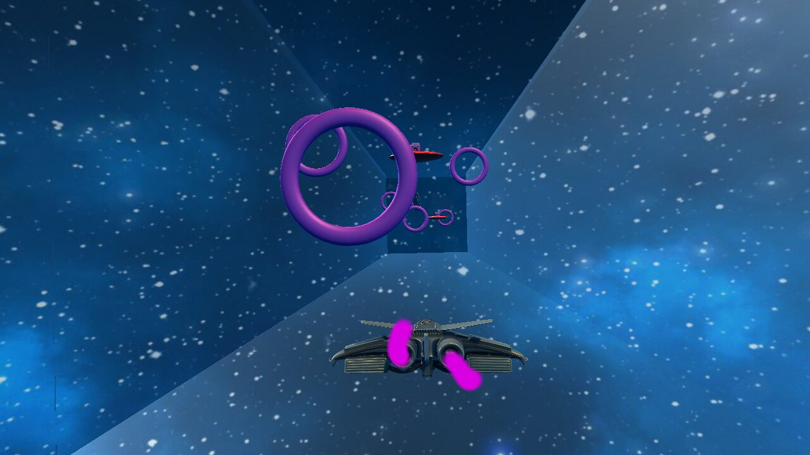
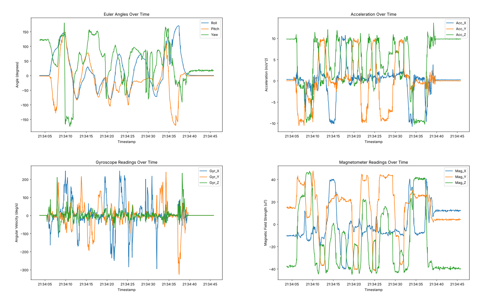
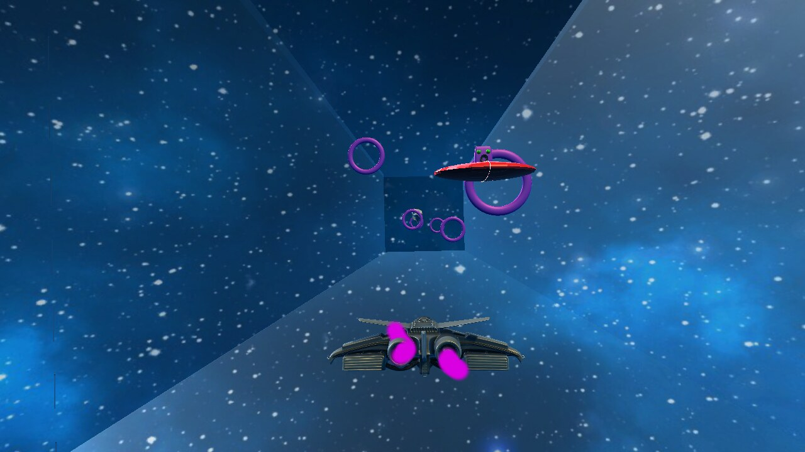

# Wireless Sensor Networks mit dem nRF52840

Übungen und Gruppenprojekt aus dem Modul „Informatik-Projekt – Wireless Sensor Networks“ im Wintersemester 2023/24. Programmiert wurde in C auf dem Nordic nRF52840 DK mit dem nRF Connect SDK (Zephyr RTOS). Vernetzt sind die Boards über Thread.

<p align="center">
  
</p>

## Projekt: Lageerkennung mit einem 9-Achsen-Sensor

Ziel war, die Ausrichtung eines Funkmoduls mit einem Bosch BNO055 (Beschleunigung, Drehrate, Magnetfeld) zu bestimmen und am PC auszuwerten.

- Zwei Sensormodule senden ihre Messdaten über ein Thread-Funknetz an ein Empfängermodul, das per UART am PC hängt.
- Das eine Modul berechnet die Lage selbst als Eulerwinkel. Das andere nutzt die Quaternionen des Sensors und rechnet sie in Eulerwinkel um.
- Ein Python-Programm liest die Daten ein, berechnet Roll-, Nick- und Gierwinkel und speichert alles mit Zeitstempel als Zeitreihe. Ein zweites Skript zeichnet die Verläufe als Diagramm.

<p align="center">
  
  <br>
  <sub>Eine rund 40 Sekunden lange Messreihe vom 6. Januar 2024 (<a href="Projekt_3D_Visualisierung/Python/csvToDia/euler_data.csv"><code>euler_data.csv</code></a>), gezeichnet mit <code>csvToDia/main.py</code></sub>
</p>

### Interstellar Ring Racer

Zum Projekt gehört außerdem das Unity-Spiel *Interstellar Ring Racer*. Man steuert ein Raumschiff durch die Ringe, indem man das Sensormodul neigt; ohne Sensor geht es auch mit der Tastatur. Die Windows-Version liegt im Release [final](https://github.com/Elia31/Wireless-Sensor-Networks/releases/tag/final).

<table>
  <tr>
    <td width="50%" align="center"><br><sub>Startbildschirm</sub></td>
    <td width="50%" align="center"><br><sub>Im Flug</sub></td>
  </tr>
</table>

### Aufbau

| Ordner in `Projekt_3D_Visualisierung/` | Inhalt |
|---|---|
| `Euler*` | Firmware-Varianten für das Sensormodul mit eigener Lageberechnung |
| `Quaternion*` | Firmware für das Sensormodul mit Quaternionen |
| `Reciever` | Empfänger, gibt die Daten per UART an den PC weiter |
| `Python/PythonInput` | Einlesen, Berechnen und Speichern der Messwerte |
| `Python/csvToDia` | Diagramme aus der gespeicherten Zeitreihe |

Die vollständige Abgabe der Gruppe liegt ebenfalls im Release [final](https://github.com/Elia31/Wireless-Sensor-Networks/releases/tag/final).

## Übungen

| Blatt | Themen | Screenshots |
|---|---|---|
| [Blatt 1](Blatt1) | GPIO: Zählerausgabe, LEDs über GPIO und Betriebssystemfunktionen, `gpio_dt_spec`, Taster | [Zähler](Blatt1/1_1_count/1_1_count_screen.jpg) |
| [Blatt 2](Blatt2) | Ein- und Ausgabe über UART, Lichtsensor am ADC, I²C-Temperatursensor direkt und über den Treiber, Timer mit Message Queue, Ampelsteuerung | [Ausgabe](Blatt2/2_1_text/Screenshot_putty.png), [Eingabe](Blatt2/2_2_input/Screenshot_input.png), [Lichtsensor](Blatt2/2_3_LDR/Screenshot_LDR_mV.png), [Temperatur](Blatt2/2_4_temp/Screenshot_temp.png), [Temperatur per Treiber](Blatt2/2_5_tempByDriver/Screenshot_tempByDriver.png), [Timer und Queue](Blatt2/2_6_temp_timer_queue/Screenshot_temp_timer_queue.png), [Ampel](Blatt2/2_7_ampel/Screenshot_ampel.png) |
| [Blatt 3](Blatt3) | Thread-Netzwerk: CLI, UDP über die API, CoAP-Server und -Client | [CLI und UDP](Blatt3/3_1_ThreadCLI/Screenshot_udp.png), [API](Blatt3/3_2_API/Screenshot_API.png), [CoAP](Blatt3/3_3_CoAP/Screenshot_CoAP.png) |

## Technik

C, nRF Connect SDK mit Zephyr RTOS, OpenThread, CoAP, UART, I²C, ADC · Python mit pyserial, pandas und Matplotlib · Unity

## Bauen

Jeder Ordner ist eine eigene Anwendung für das nRF Connect SDK. Am einfachsten geht es in VS Code mit der Erweiterung nRF Connect: Ordner öffnen, eine Build-Konfiguration für das Board `nrf52840dk_nrf52840` anlegen, bauen und flashen. Alternativ in der Kommandozeile:

```bash
west build -b nrf52840dk_nrf52840
west flash
```

Die Diagramme lassen sich auch ohne Hardware aus der mitgelieferten Messreihe erzeugen:

```bash
cd Projekt_3D_Visualisierung/Python/csvToDia
pip install pandas matplotlib
python main.py
```

## Quellen

- [WSN-IoT-Kanal auf YouTube](https://www.youtube.com/watch?v=uJVzkl73A74)
- [Toptechboy: 9-Axis IMU Lesson 20, Visualisierung von Roll, Pitch und Yaw](https://toptechboy.com/9-axis-imu-lesson-20-vpython-visualization-of-roll-pitch-and-yaw/)
